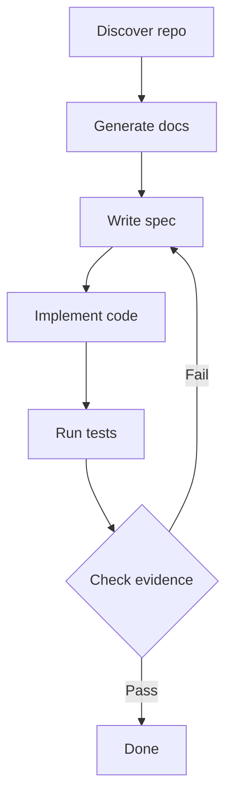

# Markflow

A universal documentation-driven development system for humans and AI agents.

Markflow helps teams keep project intent in Markdown. It gives humans and AI agents the same source to work from. It does not build your app. It builds the docs, specs, and workflows around your app so work stays consistent.

## What Markflow does

Markflow adds a docs layer to a repo that already exists. It does not init a framework. It does not install dependencies for your app. It does not change your build setup.

It reads what is already in the repo. Then it creates a clear place for intent, decisions, specs, and tasks. Humans and AI agents can then work from the same place.

## How it works

First, Markflow looks at the repo. It checks manifest files and configs to learn what stack you use. It marks what it cannot tell as TBD. It does not guess your architecture.

Next, it creates a `markflow` folder and an `AGENTS.md` file in your repo. The `markflow` folder holds your PRD, architecture notes, specs, and tasks. The `AGENTS.md` file tells an AI agent where to start and what to read.

Then you write specs in Markdown. An AI agent reads the spec, checks the coding standards, and writes code and tests. A human can do the same work without AI. The spec stays readable for both.

If a check fails, you go back to the Markdown first. You fix the spec or the code, then you test again. That loop is the core of Markflow.

## Core ideas

- Markflow adapts to your project. Your project does not adapt to Markflow.
- Markdown holds intent, requirements, and decisions. Code and tests show what the system actually does.
- One method works across languages and frameworks. Adapters handle the differences per agent and per stack.
- Work matches its size. A small bug fix does not need the same process as a large feature.
- No file is overwritten without approval. Adoption can be step by step.

Read `docs/PRINCIPLES.md` for the full list.

## Repo layout

- `docs` holds the methodology. Start with `PRINCIPLES.md`, then `PROJECT_DISCOVERY.md` and `ADAPTATION.md`.
- `README.md` is this file. It stays short.
- `CONTRIBUTING.md` explains how to help.
- `CHANGELOG.md` tracks notable changes.

## Contributing

Read `CONTRIBUTING.md` first. You can help with or without AI. Keep changes small. Use English in docs and code. Keep commit messages short and clear.

## License

Markflow uses the MIT License. See `LICENSE` for the full text.
